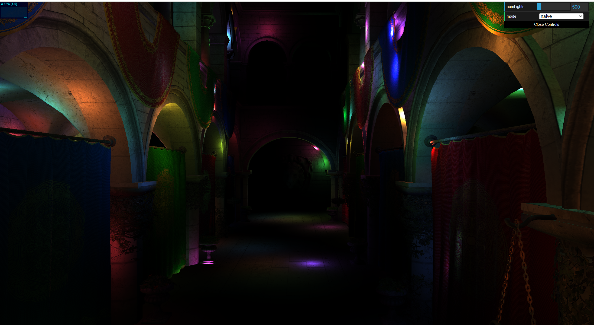
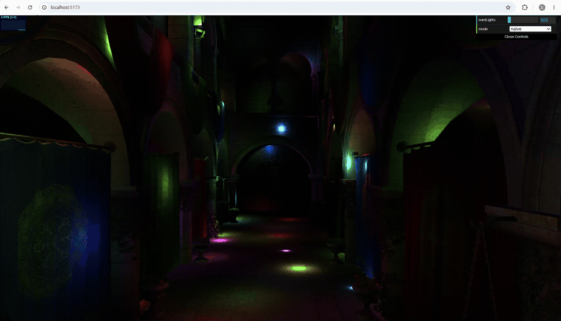
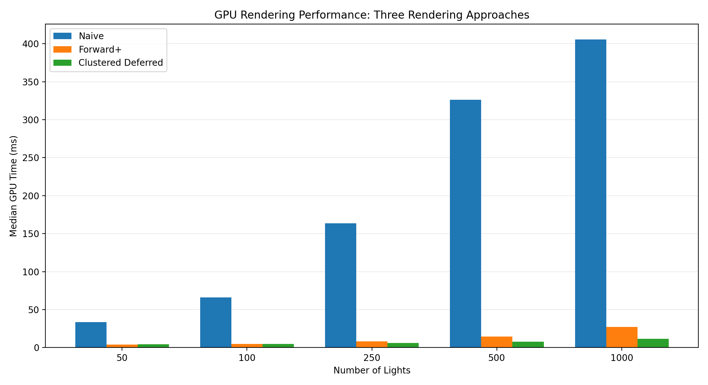
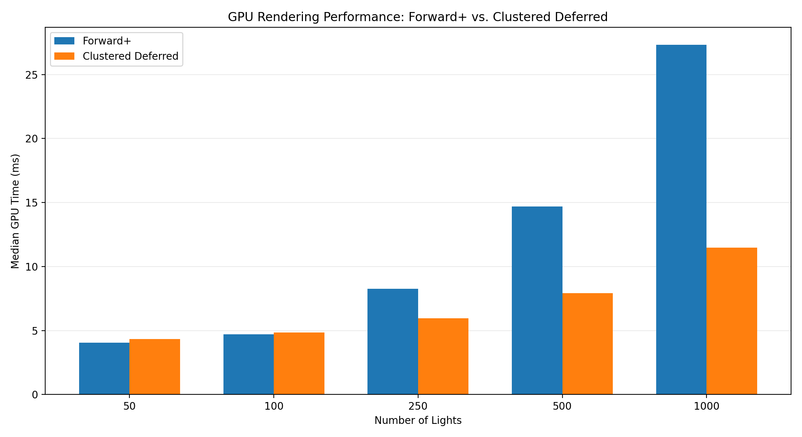
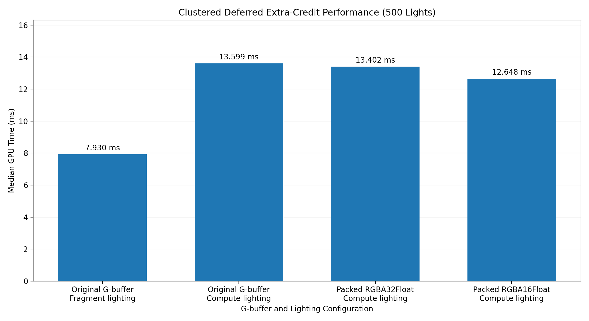

WebGPU Forward+ and Clustered Deferred Shading
======================

**University of Pennsylvania, CIS 565: GPU Programming and Architecture, Project 4**

* Ethan Yang ([GitHub](https://github.com/eyang72004))
* Tested on: Google Chrome 154.0.8037.98 (64-bit) on Windows 11, Intel Core Ultra 9 275HX, 32 GB RAM, NVIDIA GeForce RTX 5060 Laptop GPU (8 GB)

### Live Demo

https://eyang72004.github.io/Project4-WebGPU-Forward-Plus-and-Clustered-Deferred/

### Screenshot

### Demo Video/GIF

I tested all three rendering implementations with 500 moving lights. The video below shows the Naive, Forward+, and Clustered Deferred renderers in a single recording lasting approximately 58 seconds.

[Full Demonstration Video](img/project4_all_renderers_demo_compressed.mp4)

The GIFs below show each rendering implementation separately.

#### Naive Forward Shading

#### Forward+ Shading

#### Clustered Deferred Shading

## Implementation

For this project, I implemented three rendering approaches in WebGPU: Naive Forward Shading, Forward+ Shading, and Clustered Deferred Shading. I used the same scene and lighting calculations for all three implementations so that I could compare how they perform as the number of lights increases.

### Naive Forward Shading

I started with the Naive renderer, which renders the scene in a single geometry pass. I added the camera uniform buffer to the scene bind group so that the vertex shader could transform the geometry using the camera's view-projection matrix.

For the fragment shader, I sample the diffuse texture and loop through every active light in the scene. Each light contributes to the final fragment color using Lambertian diffuse shading and distance-based attenuation. I then multiply the accumulated lighting by the diffuse texture color.

I also kept the alpha test from the provided shader, which discards fragments with an alpha value below 0.5.

The main limitation is that every surviving fragment still loops through every active light, even when many of those lights are outside the configured light radius and ultimately contribute nothing to the final color. I expected this to become increasingly expensive as I increased the number of lights, which is something I examined in the performance analysis below.

### Forward+ Shading

For Forward+, I implemented a light-clustering compute shader and modified the fragment shader to use the resulting cluster light lists instead of looping through every light.

I divided the camera frustum into a three-dimensional grid of clusters. The X and Y coordinates correspond to regions of the screen, while the Z coordinate uses logarithmic depth slicing between near and far planes of 0.1 and 1000.0.

In the compute shader, each invocation processes one cluster. I first determine its X, Y, and Z coordinates from the linear cluster index. I then calculate the screen-space and depth boundaries and use the inverse projection matrix to reconstruct the eight corners of the cluster in view space.

From these corners, I construct an axis-aligned bounding box (AABB). For each active light, I transform its position into view space and test whether its influence sphere intersects the cluster's AABB. If it does, I add the light's index to the cluster's light list, up to the maximum number of lights supported by that cluster.

During the Forward+ rendering pass, I use the fragment's screen coordinates and view-space depth to determine which cluster it belongs to. The fragment shader then retrieves that cluster's light indices and evaluates only those lights.

I reused the same vertex shader and diffuse lighting function as the Naive renderer. The main difference is therefore the light-selection process.

The clustering pass introduces additional work before rendering, but I expected it to reduce the amount of lighting work performed by the fragment shader, especially as the number of lights increases.

### Clustered Deferred Shading

For Clustered Deferred, I reused the light-clustering implementation from Forward+ but separated geometry rendering and lighting into two stages. My original implementation used a G-buffer render pass followed by a fullscreen lighting render pass. I later replaced the fullscreen lighting stage with a compute shader for the extra credit, as described below.

The renderer performs three main operations:

1. Run the light-clustering compute shader.
2. Render the scene geometry into the G-buffer.
3. Perform lighting using the G-buffer and cluster light lists, either through the original fullscreen fragment shader or through the extra-credit compute shader.

#### G-buffer Pass

For my original Clustered Deferred implementation, I used two color attachments and a separate depth attachment:

| Attachment | Format | Stored Information |
|---|---|---|
| Albedo | `rgba8unorm` | Diffuse texture color |
| Normals | `rgba16float` | Normalized surface normals |
| Depth | `depth24plus` | Depth information from the geometry pass |

This was my initial G-buffer layout before the extra-credit optimization described below. The current implementation combines albedo and normals into one color attachment while keeping depth separate.

The G-buffer fragment shader samples the diffuse texture and writes the albedo and normalized surface normal. It does not perform any lighting calculations.

I also preserved the same alpha test used in the Naive and Forward+ fragment shaders.

The depth information is written through the render pass's depth attachment rather than being explicitly returned by the fragment shader.

#### Fullscreen Lighting Pass

In my original Clustered Deferred implementation, I rendered a fullscreen triangle after the G-buffer pass and performed the lighting calculations using the stored G-buffer information. I kept this fragment-based lighting path in the code, although the extra-credit compute shader is now used by default.

For each pixel, I read the albedo, normal, and depth textures. If the depth is 1.0, I treat the pixel as background and skip the lighting calculation.

Otherwise, I reconstruct the pixel's position in world space. I first convert its screen coordinates and stored depth into normalized device coordinates. I then use the inverse projection matrix to recover its view-space position and the inverse view matrix to recover its world-space position.

Using the screen coordinates and reconstructed view-space depth, I determine the pixel's cluster in the same way as Forward+.

I then loop through the lights assigned to that cluster, accumulate their contributions, and multiply the result by the stored albedo.

This means I do not need to store a separate world-position texture in the G-buffer. Instead, I reconstruct position from the depth buffer during the fullscreen pass.

Unlike Forward+, the lighting calculations are performed after the geometry pass rather than during the original geometry rendering.

### Extra Credit: G-buffer Optimization

I implemented two additional changes to the Clustered Deferred renderer: moving the deferred lighting calculations into a compute shader and reducing the G-buffer to a single color attachment.

#### Compute-Based Deferred Lighting

In the original implementation, the fullscreen fragment shader reads the G-buffer and performs the lighting calculations for each pixel. For the extra credit, I moved those calculations into a compute shader using 8 × 8 workgroups.

Each compute invocation processes one pixel. It reads the stored albedo, normal, and depth, reconstructs the world-space position, and determines which cluster contains the pixel. It then evaluates the lights assigned to that cluster using the same lighting function as the original implementation.

On devices supporting `bgra8unorm-storage`, the compute shader writes the final color directly to the canvas's `bgra8unorm` storage texture. This removes the separate fullscreen vertex and fragment presentation pass. I request the optional GPU feature when it is available and configure the canvas with storage-binding usage. For devices without this support, I kept the earlier implementation, which writes to an intermediate `rgba8unorm` storage texture and uses a fullscreen presentation pass to display the result.

I also kept the original fragment-based lighting path so that I could compare the two implementations.

#### Single-Color G-buffer

My original G-buffer used two color attachments: an `rgba8unorm` texture for albedo and an `rgba16float` texture for normals. For the extra credit, I combined these into a single `rgba16float` color attachment.

The RGB channels store the diffuse color, while the alpha channel stores an octahedrally encoded surface normal. I quantize the encoded normal into 11 bits, using 6 bits for one component and 5 bits for the other. This produces an integer between 0 and 2047, which can be represented exactly in a 16-bit floating-point channel.

During lighting, I decode the stored normal and use it with the albedo and reconstructed world-space position. The depth attachment remains separate, so I still do not need to store world position explicitly.

This reduces the color G-buffer storage from 12 bytes per pixel to 8 bytes per pixel, a reduction of approximately 33.3%. I also tested an intermediate `rgba32float` packed version before switching to `rgba16float`.

The main tradeoff is that the normal is now quantized, so some precision is lost compared with storing the original floating-point normal components. The smaller color attachment also does not guarantee a proportional improvement in rendering time, since performance depends on more than just the amount of G-buffer data stored.

### Shared Lighting Calculations

All three renderers use the same `calculateLightContrib()` function from `common.wgsl`.

For each light, I calculate the direction and distance from the surface position to the light. I use the dot product between the normalized surface normal and light direction to calculate the Lambertian diffuse contribution.

The attenuation function uses inverse-square distance attenuation together with a falloff term that limits the light's influence to the configured light radius.

The final color is calculated by multiplying the diffuse color by the sum of the relevant light contributions.

By keeping these calculations the same, I could focus the performance comparison on the differences between evaluating every light, evaluating clustered lights during forward rendering, and evaluating clustered lights during a separate fullscreen pass.

## Performance Analysis

### Benchmark Methodology

I measured GPU execution time using WebGPU timestamp queries rather than relying on the FPS counter.

For each renderer, I tested five light counts:

`50`, `100`, `250`, `500`, and `1000` lights.

I used an automated benchmark collector with 30 warmup samples followed by 100 recorded GPU timing samples for each configuration.

I report the median GPU time in milliseconds because I wanted to reduce the influence of occasional unusually high or low measurements. I also retained the individual measurements and calculated additional summary statistics.

The timing boundaries differ slightly between the three implementations because they have different rendering pipelines:

* **Naive:** I measured the geometry rendering pass.
* **Forward+:** I measured the light-clustering compute pass and the subsequent forward rendering pass.
* **Clustered Deferred:** For the original fragment-based benchmarks, I measured the light-clustering compute pass, G-buffer pass, and fullscreen lighting pass. For the direct-canvas compute implementation, I measured the light-clustering compute pass, G-buffer pass, and compute lighting pass, with the final timestamp recorded at the end of the compute pass.

This means the Forward+ and Clustered Deferred measurements include the additional passes required by their respective implementations.

I collected the measurements on the laptop listed at the beginning of this README.

I also recorded the intended benchmark conditions in `benchmarks/benchmark_config.json`. However, the earlier raw CSV files do not individually record the camera position and resolution used during each run, so I cannot independently verify those settings from the CSV files alone.

For the 500-light baseline results, I used the recordings with `(1)` in their filenames for all three renderers. These are the recordings represented in `benchmark_summary.csv` and the performance tables below.

I also retained earlier recordings of the same nominal 500-light configurations. Their median GPU times differed from the selected runs:

| Renderer | Reported Run (ms) | Alternate Run (ms) |
|---|---:|---:|
| Naive | 326.238 | 203.227 |
| Forward+ | 14.680 | 22.643 |
| Clustered Deferred | 7.930 | 7.995 |

The differences were especially noticeable for Naive and Forward+. Because the raw files do not record every test condition, I cannot determine whether these differences came from changes in the rendering environment, GPU behavior, or other factors. I therefore kept the original reported measurements but would not treat the differences between closely performing configurations as conclusive.

### 1. Effect of Increasing the Number of Lights

I compared the median GPU execution time of all three renderers as I increased the number of active lights.

| Lights | Naive (ms) | Forward+ (ms) | Clustered Deferred (ms) |
|---:|---:|---:|---:|
| 50 | 33.751 | 4.063 | 4.325 |
| 100 | 66.126 | 4.719 | 4.850 |
| 250 | 163.676 | 8.258 | 5.964 |
| 500 | 326.238 | 14.680 | 7.930 |
| 1000 | 405.733 | 27.329 | 11.469 |

### Analysis

The first thing I noticed was how much slower the Naive renderer became as I increased the number of lights.

At 50 lights, Naive took **33.751 ms**, compared with **4.063 ms** for Forward+ and **4.325 ms** for Clustered Deferred.

At 500 lights, Naive increased to **326.238 ms**, while Forward+ took **14.680 ms** and Clustered Deferred took **7.930 ms**.

This difference makes sense given how the Naive fragment shader works. Every surviving fragment loops through all active lights, so increasing the light count directly increases the number of lighting calculations performed.

Both clustered implementations avoid this by assigning lights to clusters before shading. The fragment or fullscreen lighting shader only needs to evaluate the lights associated with the relevant cluster.

However, I would not say that the clustered approaches eliminate the cost of handling all the lights. The compute shader still checks the active lights against each cluster's bounding box. The performance improvement comes from reducing the amount of lighting work performed during rendering, even after accounting for the clustering pass.

At 1000 lights, Naive measured **405.733 ms**, compared with **27.329 ms** for Forward+ and **11.469 ms** for Clustered Deferred.

The Naive measurements also do not scale perfectly proportionally with the light count. For example, increasing from 500 to 1000 lights did not double the median GPU time. I have kept the measured values rather than assuming a particular scaling relationship from the shader's loop structure alone.

### 2. Forward+ vs. Clustered Deferred

I also compared Forward+ and Clustered Deferred separately because the much larger Naive timings make the differences between the two optimized implementations harder to see on the first graph.

The results were interesting because Clustered Deferred was not faster at every light count.

At 50 lights, Forward+ measured **4.063 ms**, compared with **4.325 ms** for Clustered Deferred.

At 100 lights, Forward+ was still slightly faster, measuring **4.719 ms** compared with **4.850 ms**.

The differences at 50 and 100 lights were small, so I would not take these individual benchmark runs as conclusive evidence that Forward+ is consistently faster at lower light counts. The larger differences at 250, 500, and 1000 lights provide stronger evidence of the performance advantage I observed for Clustered Deferred in this scene.

However, the relationship changed at 250 lights. Forward+ measured **8.258 ms**, while Clustered Deferred measured **5.964 ms**.

The difference continued to increase at 500 and 1000 lights.

| Lights | Forward+ (ms) | Clustered Deferred (ms) | Faster Implementation |
|---:|---:|---:|:---|
| 50 | **4.063** | 4.325 | Forward+ |
| 100 | **4.719** | 4.850 | Forward+ |
| 250 | 8.258 | **5.964** | Clustered Deferred |
| 500 | 14.680 | **7.930** | Clustered Deferred |
| 1000 | 27.329 | **11.469** | Clustered Deferred |

I think this crossover is consistent with the additional work required by deferred rendering.

Clustered Deferred has to create and write the G-buffer, then read those textures during the fullscreen lighting pass. At smaller light counts, that extra work can offset some of the benefit of separating geometry rendering from lighting.

As the light count increases, however, the cost of lighting becomes more important. Clustered Deferred performs lighting in a separate fullscreen pass, while Forward+ performs lighting during geometry rendering.

This could help explain why Clustered Deferred performs better at the higher light counts in my measurements.

I did not separately time the clustering, G-buffer, and fullscreen lighting stages, so I cannot determine exactly how much time each stage contributes to the total. I would therefore treat this as an explanation consistent with the implementation and results rather than a directly measured breakdown.

### 3. Performance at 500 Lights

I also looked more closely at the 500-light configuration because I used this light count for the demonstration GIFs.

| Renderer | Median GPU Time (ms) |
|---|---:|
| Naive | 326.238 |
| Forward+ | 14.680 |
| Clustered Deferred | **7.930** |

At 500 lights, Naive took approximately **22.2x as long as Forward+**.

Naive also took approximately **41.1x as long as Clustered Deferred**.

Forward+ took approximately **1.85x as long as Clustered Deferred**.

These differences are substantial, especially considering that both optimized implementations include the clustering compute pass in their measured GPU time.

The results show why evaluating every light for every fragment becomes expensive in a scene with many lights. They also show that the choice between Forward+ and Clustered Deferred can matter even when both use the same cluster light lists.

### 4. Performance Conclusions

From these benchmarks, I found that both Forward+ and Clustered Deferred performed substantially better than Naive Forward Shading at every tested light count.

The Naive implementation became increasingly expensive because every fragment evaluates all active lights.

Forward+ reduced that cost by using clustered light lists, although it still performs lighting during the geometry pass.

Clustered Deferred added a G-buffer pass and performed lighting separately using the stored surface information. It was slightly slower than Forward+ at 50 and 100 lights, but faster at 250, 500, and 1000 lights.

I would not conclude that Clustered Deferred is always faster than Forward+, since these results come from one scene, one GPU, and the specific implementations used in this project. Different scene complexity, screen resolution, and light distributions could change the results.

What I can conclude from my measurements is that **clustered light selection provided a substantial performance improvement over the Naive approach**, and that **Clustered Deferred scaled better than Forward+ over the higher light counts I tested**.

### 5. Extra-Credit G-buffer Optimization Performance

I also benchmarked the changes I made for the G-buffer optimization extra credit. For these tests, I used 500 moving lights, with 30 warmup samples followed by 100 recorded GPU timing samples per configuration.

I tested the original fragment-based Clustered Deferred renderer, then three versions using compute-based lighting and different G-buffer layouts.

| Configuration | Median GPU Time (ms) |
|---|---:|
| Original G-buffer, fragment lighting | 7.930 |
| Original G-buffer, compute lighting | 13.599 |
| Packed `rgba32float` G-buffer, compute lighting | 13.402 |
| Packed `rgba16float` G-buffer, compute lighting | **12.648** |

The first result comes from my original renderer benchmarks. The other three results come from the extra-credit measurements. Since these were collected in separate runs, I would not treat the differences as a perfectly controlled comparison.

#### Compute-Based Lighting

Moving the lighting calculations into a compute shader did not improve performance in my measurements. With the original G-buffer, the compute-based version took 13.599 ms, compared with 7.930 ms for the original fragment-based implementation.

One possible reason for the slower compute-based results is that the versions I benchmarked at this stage used an intermediate storage texture and a separate fullscreen presentation pass. Although the lighting calculations were performed in compute, the results still had to be written to a texture and read again for presentation. I later implemented direct-canvas compute output on supported hardware, which removes that additional presentation pass.

I did not separately measure the compute lighting and presentation passes, so I cannot determine exactly how much each contributes to the additional time.

#### Direct-Canvas Compute Output

After implementing direct-canvas compute output, I ran two additional benchmarks with 500 moving lights. Each run used 30 warmup samples followed by 100 recorded GPU timing samples.

| Run | Median GPU Time (ms) |
|---|---:|
| Direct-canvas compute, Run 1 | 12.059 |
| Direct-canvas compute, Run 2 | 7.635 |

The results varied substantially between the two runs, even though both used the same nominal light count and rendering implementation. I cannot determine the cause of this variation from the timing measurements alone.

The direct-canvas implementation removes the additional fullscreen presentation pass on supported hardware, but these measurements are not sufficient to establish a consistent performance improvement over the earlier compute or fragment-based implementations.

#### Packed G-buffer

After implementing compute-based lighting, I tested two versions of the packed G-buffer.

The first version used a single `rgba32float` color attachment. This reduced the number of color attachments from two to one, but increased the color G-buffer storage from 12 bytes per pixel to 16 bytes per pixel.

Its median GPU time was 13.402 ms, slightly lower than the 13.599 ms measured with the original G-buffer and compute lighting.

I then switched to `rgba16float` and reduced the packed normal representation to 11 bits. This brought the color G-buffer storage down to 8 bytes per pixel.

The `rgba16float` version measured 12.648 ms, approximately 5.6% lower than the `rgba32float` packed version and 7.0% lower than the original G-buffer with compute lighting.

These results suggest that reducing the G-buffer's storage requirements may help performance in this implementation. However, the differences are based on individual benchmark runs, and I cannot isolate memory bandwidth as the cause without additional measurements.

#### Tradeoffs and Further Improvements

The main benefit of the packed G-buffer is its smaller color-attachment footprint. However, compressing the surface normal introduces quantization error, so the decoded normal is not guaranteed to match the original normal exactly.

The compute-lighting path also remained slower than the original fragment-lighting path, even after G-buffer compression.

I subsequently implemented direct-canvas compute output on supported hardware, removing the intermediate texture and fullscreen presentation pass from that path. Further work could include testing different compute workgroup sizes and measuring the clustering, G-buffer, and lighting stages separately to better understand where GPU time is spent.

Among the earlier compute-lighting configurations I benchmarked, the packed `rgba16float` G-buffer produced the lowest median GPU time. The later direct-canvas measurements varied substantially between runs, so I cannot draw a firm conclusion about its performance relative to those earlier configurations.

## Benchmark Data

I saved the raw GPU timing measurements and generated the performance graphs using a Python plotting script.

The benchmark files include:

* `benchmarks/benchmark_summary.csv`: Summary statistics for the 15 tested configurations.
* `benchmarks/benchmark_config.json`: Documented benchmark configuration.
* `benchmarks/plot_benchmarks.py`: Script used to generate the performance graphs.
* `benchmarks/graphs/gpu_time_all_renderers.png`: Comparison of all three renderers.
* `benchmarks/graphs/gpu_time_optimized_renderers.png`: Comparison of Forward+ and Clustered Deferred.
* `benchmarks/graphs/gpu_time_extra_credit.png`: Comparison of the original Clustered Deferred implementation and three extra-credit configurations at 500 lights.
* `benchmarks/raw/gpu_clustered_deferred_500_original_gbuffer_compute.csv`, `benchmarks/raw/gpu_clustered_deferred_500_packed_rgba32float_compute.csv`, and `benchmarks/raw/gpu_clustered_deferred_500_packed_rgba16float_compute.csv`: Raw GPU timing measurements for the three extra-credit compute-lighting configurations.

I retained the raw CSV measurements rather than keeping only the final medians. Each selected configuration contains 100 recorded GPU timing samples after the warmup period.

### Deployment Notes

I deployed the project through GitHub Pages. To make the production build work, I moved the Sponza scene files into Vite's `public/` directory, updated the scene-loading path to use `import.meta.env.BASE_URL`, and adjusted the build script and GitHub Actions workflow for the repository's deployment path.

I also replaced the original `eval()`-based shader constant substitution with explicit string replacement. The original approach caused shader constants to become `undefined` in the production build, which prevented the renderers from working on GitHub Pages.

I tested the production build locally and verified that all three rendering modes work on the deployed site.

### Credits
- [Vite](https://vitejs.dev/)
- [loaders.gl](https://loaders.gl/)
- [dat.GUI](https://github.com/dataarts/dat.gui)
- [stats.js](https://github.com/mrdoob/stats.js)
- [wgpu-matrix](https://github.com/greggman/wgpu-matrix)
